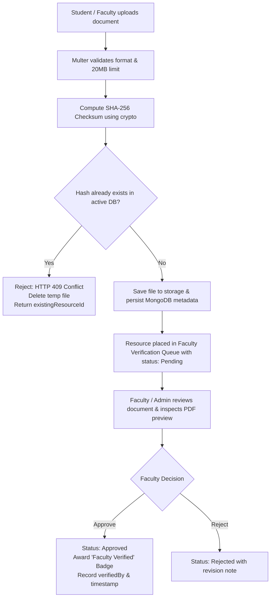

# CampusNotes — Centralized Academic Study Material Sharing Platform

[](https://nodejs.org/)
[](https://react.dev/)
[](https://tailwindcss.com/)
[](https://www.mongodb.com/)
[](https://vitest.dev/)
[](LICENSE)

**CampusNotes** is a complete, production-grade MERN stack platform designed to eliminate the chaos of scattered study materials across WhatsApp groups, Telegram channels, personal Google Drive links, and fragmented chats. It provides students and faculty with an organized, verified, and accessible repository for educational materials.

---

## 📑 Table of Contents

- [🏛️ Academic Hierarchy](#️-academic-hierarchy)
- [⚡ Key Features & System Architecture](#-key-features--system-architecture)
- [🔑 Pre-Seeded Evaluation Accounts](#-pre-seeded-evaluation-accounts)
- [🛠️ Technology Stack](#️-technology-stack)
- [📂 Complete Repository Structure](#-complete-repository-structure)
- [🚀 Quick Start & Installation](#-quick-start--installation)
- [🧪 Running Automated Tests](#-running-automated-tests)
- [🎯 Interactive Feature Testing Guide](#-interactive-feature-testing-guide)
- [📡 Complete REST API Reference](#-complete-rest-api-reference)
- [📮 Postman Collection](#-postman-collection)
- [🚢 Production Deployment](#-production-deployment)
- [📦 Deliverables Checklist](#-deliverables-checklist)

---

## 🏛️ Academic Hierarchy

Every educational resource on CampusNotes strictly follows a 5-tier organizational hierarchy:

```
Department (e.g. Computer Engineering)
 └── Semester (e.g. Semester 5)
      └── Subject (e.g. Operating Systems — CS501)
           └── Unit (e.g. Unit 3: CPU Scheduling & Process Synchronization)
                └── Resource (e.g. Operating Systems Unit 3 Notes.pdf)
```

---

## ⚡ Key Features & System Architecture

### 1. Verification & Duplicate Detection Workflow



### 2. Core Functional Highlights
- **Server-Enforced Role-Based Access Control (RBAC):** Exactly three roles (`Student`, `Faculty`, `Admin`) enforced through backend authentication & authorization middleware.
- **Cryptographic Duplicate Detection:** Files are hashed using Node.js `crypto` with SHA-256. If a file was previously uploaded, the upload is rejected with `HTTP 409 Conflict` and the user is provided a direct link to the existing canonical resource.
- **Faculty Verification Queue:** Faculty members can review student contributions, inspect documents, and issue the official **"Faculty Verified"** badge with verification notes.
- **Embedded Document Preview:** In-browser PDF previewer supporting page navigation, zoom, and open-in-new-tab controls without forcing automatic downloads.
- **Controlled Streaming Downloads:** Dedicated download endpoints validate access, safely stream local files, and increment download counters atomically.
- **Dependent Filtering & Search:** Search by keywords with debouncing and filter across Department → Semester → Subject → Unit → Resource Type.
- **Personalized Bookmarks & Uploads:** Students can bookmark materials for revision and manage their personal contributions.
- **Community Reporting & Admin Moderation:** Users can report inaccurate or inappropriate content. Administrators review reports, mark them under review, resolve them, and optionally remove resources with automated file cleanup.
- **Collapsible Application Shell:** Modern desktop sidebar that toggles between expanded and compact icon-only states (with tooltips) and collapses into a touch-friendly drawer on mobile devices.

---

## 🔑 Pre-Seeded Evaluation Accounts

The platform includes automated seed scripts that populate departments, subjects, syllabus units, sample verified notes, and evaluation accounts:

| Role | Email | Password | Permissions & Capabilities |
|---|---|---|---|
| **Student** | `student@campusnotes.edu` | `StudentPassword@123` | Browse, filter, search, upload notes, bookmark, download, submit reports, edit own resources. |
| **Faculty** | `faculty@campusnotes.edu` | `FacultyPassword@123` | All student capabilities + Verification Queue, document preview modal, approval/rejection with notes, view verified history. |
| **Admin** | `admin@campusnotes.edu` | `AdminPassword@123` | All capabilities + 4-stat Dashboard, User role/active management, Academic structure CRUD, Report resolution, Platform moderation. |

> **💡 Quick Testing Tip:** On the Sign In page (`/login`), click the **"Quick Fill Evaluation Accounts"** buttons (`Student`, `Faculty`, or `Admin`) to populate credentials with a single click.

---

## 🛠️ Technology Stack

| Layer | Technologies |
|---|---|
| **Frontend** | React 18, Vite, Tailwind CSS, Lucide React, React Router DOM (v6), Axios, React Hot Toast |
| **Backend** | Node.js (ES Modules), Express.js, Multer, Node Crypto (SHA-256), Helmet, CORS, Express Rate Limit, Cookie Parser |
| **Database** | MongoDB (v6/v7/v8) with Mongoose ODM, Compound Unique Indexes, Text Indexes, TTL Indexes |
| **Validation** | Zod schemas on both client and backend middleware |
| **Testing** | Vitest, Supertest (19 integration & security tests) |

---

## 📂 Complete Repository Structure

```
campusnotes/
├── package.json                         # Root convenience runner scripts
├── README.md                             # Comprehensive project documentation
├── TASK_MEMORY.md                        # Persistent state & progress memory tracker
├── campusnotes.postman_collection.json   # Ready-to-import Postman collection
├── .gitignore                            # Git ignore configuration
│
├── server/
│   ├── package.json                      # Backend dependencies & test scripts
│   ├── .env / .env.example               # Environment variables configuration
│   ├── scripts/
│   │   ├── seedAcademicData.js           # Seeds Departments, Subjects, Units, Users, Sample Notes
│   │   └── seedAdmin.js                  # Seeds Master Administrator account
│   ├── tests/
│   │   └── api.test.js                   # 19 automated integration and security tests
│   ├── uploads/                          # Local file storage directory
│   └── src/
│       ├── config/                       # DB connection, Env parser, Storage driver
│       ├── models/                       # User, Department, Subject, Unit, Resource, Bookmark, Report, Session
│       ├── middleware/                   # authenticate, authorizeRoles, errorHandler, notFound, upload, validate
│       ├── validators/                   # Zod validation schemas
│       ├── services/                     # Business logic: auth, academic, storage, resource, report
│       ├── controllers/                  # Route controllers
│       ├── routes/                       # Express router modules (/api/v1)
│       ├── utils/                        # ApiError, apiResponse, asyncHandler, hashFile
│       ├── app.js                        # Express app configuration
│       └── server.js                     # Server entry point
│
└── client/
    ├── package.json                      # Frontend dependencies & build scripts
    ├── vite.config.js                    # Vite configuration
    ├── tailwind.config.js                # Tailwind CSS theme configuration
    ├── postcss.config.js                 # PostCSS setup
    ├── index.html                        # HTML entry point with fonts
    ├── .env / .env.example               # Frontend environment variables
    └── src/
        ├── api/                          # Axios instances and endpoint calls
        ├── context/                      # AuthContext (state, persistent sessions, roles)
        ├── layouts/                      # AppLayout, Sidebar (collapsible/mobile), Header, PublicLayout
        ├── components/ui/                # Button, Input, Select, Modal, ConfirmDialog, StatusBadge,
        │                                 # EmptyState, LoadingSkeleton, Pagination, PDFViewer, ResourceCard
        ├── pages/                        # LandingPage, Login, Register, ForgotPassword, ResetPassword,
        │                                 # Dashboard, BrowseResources, ResourceDetails, UploadResource,
        │                                 # MyUploads, MyBookmarks, MyReports, VerificationQueue,
        │                                 # FacultyVerifiedList, AdminDashboard, AdminUsers,
        │                                 # AdminResources, AdminReports, AdminAcademic, Profile, NotFound
        ├── routes/                       # AppRoutes, ProtectedRoute, RoleGuard
        ├── App.jsx                       # Root app wrapper
        ├── main.jsx                      # DOM mount
        └── index.css                     # Global styles & custom scrollbars
```

---

## 🚀 Quick Start & Installation

### 1. Prerequisites
- **Node.js** (v18.0.0 or higher)
- **npm** (v9.0.0 or higher)
- **MongoDB** running locally on port `27017` (e.g. MongoDB Community Server) or a MongoDB Atlas URI

### 2. Environment Configuration

The repository comes pre-configured with ready-to-run `.env` files. If setting up manually:

**Server Environment (`server/.env`):**
```env
PORT=5000
NODE_ENV=development
MONGODB_URI=mongodb://127.0.0.1:27017/campusnotes
JWT_ACCESS_SECRET=campusnotes_jwt_access_super_secret_key_2026_dev_mode_secure
JWT_ACCESS_EXPIRES_IN=7d
CLIENT_URL=http://localhost:5173
STORAGE_DRIVER=local
LOCAL_UPLOAD_DIR=uploads
MAX_FILE_SIZE_MB=20
ADMIN_NAME="System Administrator"
ADMIN_EMAIL="admin@campusnotes.edu"
ADMIN_PASSWORD="AdminPassword@123"
```

**Client Environment (`client/.env`):**
```env
VITE_API_BASE_URL=http://localhost:5000/api/v1
```

### 3. Install Dependencies

In the root directory or respective subdirectories:

```bash
# Install backend dependencies
cd server
npm install

# Install frontend dependencies
cd ../client
npm install

cd ..
```

### 4. Seed the Database

Run the idempotent seed scripts to initialize departments, subjects, units, sample verified notes, and evaluation users:

```bash
# Seed departments, subjects, units, student, faculty, and sample PDF notes
npm run seed:academic

# Seed master administrator account
npm run seed:admin
```

### 5. Running the Application

You can launch both applications using two terminal windows:

#### Option A: Two Separate Terminals

**Terminal 1 — Backend API Server:**
```bash
cd server
npm run dev
# Server running at: http://localhost:5000
# API Base URL:     http://localhost:5000/api/v1
```

**Terminal 2 — Frontend Client:**
```bash
cd client
npm run dev
# Client running at: http://localhost:5173
```

#### Option B: Root Scripts

From the root `campusnotes` folder:
```bash
# Start backend in dev mode
npm run server

# In another terminal, start frontend in dev mode
npm run client
```

Now open **[http://localhost:5173](http://localhost:5173)** in your browser.

---

## 🧪 Running Automated Tests

The backend test suite verifies authentication, privilege escalation prevention, role permissions, SHA-256 duplicate detection, faculty verification, bookmarking, reporting, and file streaming downloads.

```bash
cd server
npm test
```

### Test Suite Output:
```
 ✓ tests/api.test.js (19 tests) 679ms
   ✓ 1. Authentication & Role Enforcement > should register a new user as Student (regardless of client attempt to escalate)
   ✓ 1. Authentication & Role Enforcement > should reject registration with duplicate email
   ✓ 1. Authentication & Role Enforcement > should reject login with wrong password
   ✓ 1. Authentication & Role Enforcement > should get current authenticated user profile
   ✓ 2. Authorization Boundaries > should reject student from accessing admin dashboard stats
   ✓ 2. Authorization Boundaries > should allow admin to access admin dashboard stats
   ✓ 3. Academic Structure & Hierarchy Validation > should retrieve departments and find Computer Engineering
   ✓ 3. Academic Structure & Hierarchy Validation > should retrieve subjects for CE semester 5 and find Operating Systems
   ✓ 3. Academic Structure & Hierarchy Validation > should retrieve units for Operating Systems and find Unit 3
   ✓ 4. Resource Upload & SHA-256 Duplicate Detection > should upload a new resource with valid academic hierarchy
   ✓ 4. Resource Upload & SHA-256 Duplicate Detection > should REJECT duplicate upload with HTTP 409 and return existingResourceId
   ✓ 5. Faculty Verification Workflow > should reject student attempt to verify resource
   ✓ 5. Faculty Verification Workflow > should allow faculty to verify and approve resource
   ✓ 6. Bookmarks & Reporting > should allow user to bookmark resource
   ✓ 6. Bookmarks & Reporting > should list bookmarked resource in my bookmarks
   ✓ 6. Bookmarks & Reporting > should allow user to submit a report on resource
   ✓ 6. Bookmarks & Reporting > should remove bookmark successfully
   ✓ 7. File Preview & Download Stream > should support previewing uploaded PDF
   ✓ 7. File Preview & Download Stream > should support downloading file and increment download count

Test Files  1 passed (1)
Tests       19 passed (19)
```

---

## 🎯 Interactive Feature Testing Guide

### 1. Test as Student (`student@campusnotes.edu` / `StudentPassword@123`)
1. Click **Student** on the login page and sign in.
2. **Dashboard:** View recently added and faculty-verified materials.
3. **Browse Resources:** Filter by `Computer Engineering` → `Semester 5` → `Operating Systems` → `Unit 3`.
4. **Resource Details:** Click on the "Operating Systems Unit 3 Notes". Test the **In-Browser PDF Preview**, click **Save to Bookmarks**, and test **Download Material** (verifying the download count increments).
5. **Report an Issue:** Click **Report Issue**, choose `Wrong or Irrelevant Material`, and submit.
6. **Upload a Note:** Go to `/upload`, upload any PDF/DOCX file, select the hierarchy, and submit. If you attempt to upload the exact same file again, observe the **SHA-256 Duplicate Check Alert** with a direct button linking to the existing resource.

### 2. Test as Faculty (`faculty@campusnotes.edu` / `FacultyPassword@123`)
1. Sign in as Faculty.
2. Open **Verification Queue** from the sidebar.
3. Click **Quick Preview** to inspect any student-uploaded material in an embedded PDF preview modal.
4. Click **Review & Decide**, select **Approved**, enter a faculty endorsement note (e.g., *"Accurate notes adhering to syllabus"*), and submit.
5. Notice that the resource now displays the green **"Faculty Verified"** badge.
6. View **My Verified Resources** to see historical materials verified by your account.

### 3. Test as Admin (`admin@campusnotes.edu` / `AdminPassword@123`)
1. Sign in as Admin.
2. **Admin Dashboard:** View the 4 live platform counts (Total Users, Resources, Pending Reports, Subjects).
3. **User Management:** Search users, change roles between Student/Faculty/Admin, or toggle account status. (Self-deactivation and removing the last administrator are safely blocked).
4. **Academic Structure:** Switch between tabs (**Departments**, **Subjects**, **Unit Modules**). Test adding a new unit or subject and see real-time updates across the platform.
5. **Report Management:** Review the report submitted earlier, inspect the associated note, mark it as `Resolved`, or choose to remove the resource.
6. **Resource Moderation:** Remove any inappropriate material and verify its physical file is safely deleted from disk.

---

## 📡 Complete REST API Reference

Base API Route: `/api/v1`

### Authentication Endpoints
| Method | Route | Description | Auth Required |
|---|---|---|---|
| `POST` | `/auth/register` | Register new student account (always role: `Student`) | Public |
| `POST` | `/auth/login` | Authenticate user & issue JWT cookie/token | Public |
| `POST` | `/auth/logout` | Invalidate current session and clear cookie | Authenticated |
| `GET` | `/auth/me` | Fetch authenticated user profile | Authenticated |
| `POST` | `/auth/forgot-password` | Issue SHA-256 password reset token | Public |
| `POST` | `/auth/reset-password` | Reset password using valid token | Public |

### Academic Structure Endpoints
| Method | Route | Description | Auth Required |
|---|---|---|---|
| `GET` | `/departments` | List all active departments | Public |
| `POST` | `/departments` | Create new department | Admin |
| `PATCH` | `/departments/:id` | Update department details | Admin |
| `DELETE` | `/departments/:id` | Delete department (checks for dependencies) | Admin |
| `GET` | `/subjects` | Query subjects (filters: `department`, `semester`) | Public |
| `POST` | `/subjects` | Create new subject with unique code | Admin |
| `PATCH` | `/subjects/:id` | Update subject details | Admin |
| `DELETE` | `/subjects/:id` | Delete subject (checks for dependencies) | Admin |
| `GET` | `/subjects/:id/units` | List units for a subject | Public |
| `POST` | `/subjects/:id/units` | Create syllabus unit module | Admin |
| `PATCH` | `/units/:id` | Update unit details | Admin |
| `DELETE` | `/units/:id` | Delete unit module | Admin |

### Resources & Materials Endpoints
| Method | Route | Description | Auth Required |
|---|---|---|---|
| `GET` | `/resources` | Filter & search materials (`q`, `department`, `semester`, `subject`, `unit`, `type`, `sort`, `page`) | Public / Optional |
| `POST` | `/resources` | Upload material (Multer 20MB + SHA-256 duplicate check) | Authenticated |
| `GET` | `/resources/:id` | Retrieve full resource details | Public / Optional |
| `PATCH` | `/resources/:id` | Edit resource title, description, or tags | Owner or Admin |
| `DELETE` | `/resources/:id` | Delete resource and clean up physical file | Owner or Admin |
| `GET` | `/resources/:id/preview` | In-browser document stream (`Content-Disposition: inline`) | Public / Optional |
| `GET` | `/resources/:id/download` | Stream file attachment & increment download count | Public / Optional |
| `GET` | `/resources/queue` | List materials pending review | Faculty or Admin |
| `PATCH` | `/resources/:id/verification` | Approve or reject material with note | Faculty or Admin |
| `POST` | `/resources/:id/bookmark` | Bookmark a resource | Authenticated |
| `DELETE` | `/resources/:id/bookmark` | Remove resource from bookmarks | Authenticated |
| `POST` | `/resources/:id/reports` | Submit community moderation report | Authenticated |

### Admin Endpoints
| Method | Route | Description | Auth Required |
|---|---|---|---|
| `GET` | `/admin/dashboard` | Primary statistics & recent platform activity | Admin |
| `GET` | `/admin/users` | Search, filter, and paginate user accounts | Admin |
| `PATCH` | `/admin/users/:id` | Change role (`Student`/`Faculty`/`Admin`) or toggle active | Admin |
| `GET` | `/admin/resources` | List all platform resources | Admin |
| `DELETE` | `/admin/resources/:id` | Moderate and remove resource with file cleanup | Admin |
| `GET` | `/admin/reports` | List community reports (filter by `status`, `reason`) | Admin |
| `PATCH` | `/admin/reports/:id` | Resolve, reject, or moderate reported resource | Admin |

---

## 📮 Postman Collection

The file [campusnotes.postman_collection.json](file:///c:/Users/vbhan/Downloads/campusnotes/campusnotes.postman_collection.json) is included in the project root.

### Importing into Postman:
1. Open Postman.
2. Click **Import** in the upper left.
3. Select `campusnotes.postman_collection.json`.
4. The collection is pre-configured with collection variables:
   - `baseUrl`: `http://localhost:5000/api/v1`
   - Pre-configured login requests for Student, Faculty, and Admin.

---

## 🚢 Production Deployment

### 1. Frontend (Vercel / Netlify / Cloudflare Pages)
- Build command: `npm run build`
- Output directory: `dist`
- Environment variables:
  - `VITE_API_BASE_URL`: `https://your-api-domain.com/api/v1`

### 2. Backend (Render / Railway / DigitalOcean / AWS EC2)
- Build command: `npm install`
- Start command: `node src/server.js`
- Environment variables:
  - `NODE_ENV`: `production`
  - `PORT`: `5000`
  - `MONGODB_URI`: `mongodb+srv://<username>:<password>@cluster.mongodb.net/campusnotes`
  - `JWT_ACCESS_SECRET`: `secure_random_production_secret`
  - `CLIENT_URL`: `https://your-client-domain.com`
  - `MAX_FILE_SIZE_MB`: `20`

### 3. Database (MongoDB Atlas)
- Create a Mongoose cluster on MongoDB Atlas.
- Whitelist the backend hosting IP address or allow all (`0.0.0.0/0`) with strong credentials.
- Paste the connection string into `MONGODB_URI`.

### 4. Storage Driver Adapter
- For persistent cloud storage on ephemeral serverless platforms, replace the local driver in `server/src/services/storage.service.js` with an S3-compatible or Cloudinary adapter using the same interface methods (`getFilePath`, `deleteFile`, `getFileStream`).

---

## 📦 Deliverables Checklist

- [x] Complete React frontend with Tailwind CSS and Lucide React
- [x] Complete Node.js / Express backend with ES modules
- [x] All 8 MongoDB Mongoose schemas with compound indexes and validation
- [x] Cryptographic SHA-256 duplicate detection with `HTTP 409 Conflict` & existing link
- [x] Role-based access control (`Student`, `Faculty`, `Admin`)
- [x] Collapsible desktop sidebar and responsive mobile drawer
- [x] In-browser PDF previewer and download count tracker
- [x] Faculty verification queue and "Faculty Verified" badge
- [x] Interactive bookmarking and community reporting system
- [x] Repeatable database seed scripts (`seedAcademicData.js`, `seedAdmin.js`)
- [x] Automated test suite (19 passing integration tests)
- [x] Postman API collection (`campusnotes.postman_collection.json`)
- [x] Persistent memory tracking file (`TASK_MEMORY.md`)
